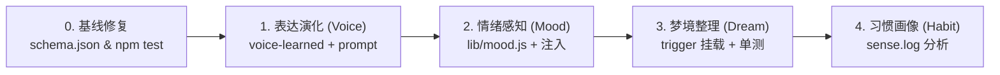

# @dsh/heart 现有实现与增量扩展逐项对照表 (Plan 对齐基准)

> **基准代码库**: `d:\CodePackage\DSHA\projects\heart-plugin`  
> **Git Commit**: `7fc0c20` (HEAD -> main, tag: v0.15.2)  
> **验证状态**: Node 原生测试通过 `60/60 tests pass, 0 fail` (耗时 ~802ms)  
> **目的**: 严格遵循 GPT 与用户的建议，完成“一致性核对 → 核心审查 → 增量对照”，确保不重复造轮子、不破坏现有逻辑。

---

## 目录
1. [阶段一：源码与文档一致性核对结果 (核对报告)](#阶段一源码与文档一致性核对结果)
2. [阶段二：核心模块实现现状与测试边界 (代码事实)](#阶段二核心模块实现现状与测试边界)
3. [阶段三：现有能力复用与反重复设计清单](#阶段三现有能力复用与反重复设计清单)
4. [阶段四：【现有实现 → 新 Plan → 必须修改项】逐项对照表](#阶段四现有实现--新-plan--必须修改项逐项对照表)
5. [增量落地开发工作流 (Next Steps)](#增量落地开发工作流)

---

## 阶段一：源码与文档一致性核对结果

在展开任何新特性前，我们首先对本地工作区代码与仓库历史进行了全量核对：

| 核对项 | 源码实际情况 (`main` 分支) | 文档/历史记录情况 | 一致性结论与修复要求 |
|---|---|---|---|
| **Git 状态** | `main` 分支，Working tree clean | 最新提交为 `v0.15.2` (`7fc0c20`) | 完全一致 |
| **package.json** | `"version": "0.15.2"` | README 与 CHANGELOG 均记录到 0.15.2 | 完全一致 |
| **Schema 版本** | 代码中 `SCHEMA_VERSION = 3` (`lib/store.js:16`) | 仓库根目录下 `schema.json` 内容为 `"version": 2` | ⚠️ **需修改项**: 根目录的模板 `schema.json` 遗留了 `version: 2`，而实际启动迁移后运行时会升为 `3`。本次增量中需将根目录 `schema.json` 修正为 `"version": 3` 并补充说明。 |
| **数据迁移逻辑** | `migrate()` 支持 `< 3` 阶段：将 `CORE.md`/`RELATIONSHIP.md` 命名为 `legacy-*`，清理空 `handoff` 目录；每次启动运行幂等的 `migrateProvenance()` 补 `unknown` | 与 CHANGELOG 0.14.0/0.15.0 记录一致 | 正常，新增扩展不需要变更 Schema 版本 |
| **配置文件管理** | `config.json` 独立于 Cordis 宿主，`readHeartConfig()` 动态重读；`DEFAULT_CONFIG` 兜底全部键 | README 说明了“宿主重写 cordis，参数放 config.json” | 完全一致，新扩展配置直接扩充 `DEFAULT_CONFIG` |
| **测试套件框架** | Node.js 原生 `node:test` + `node:assert/strict`，共 6 个测试文件 | package.json 未定义 `npm test` 脚本 | 💡 **需补全项**: 建议在 `package.json` 的 `scripts` 中补上 `"test": "node --test test/*.test.js"` |

---

## 阶段二：核心模块实现现状与测试边界

工作区中运行 `node --test test/*.test.js` 结果为 **60 个单测全部通过**。核心代码边界清晰，责任分离严密：

### 1. `lib/store.js` (970 行，纯逻辑内核，29 个单测覆盖)
- **职责**: 负责文件 IO（本子、事实、情节、器官、出处索引、导入导出）。
- **关键设计**:
  - `NOTEBOOK_HEADER`: 纯空模板，绝不包含预设人格；
  - `appendMemory`: 严格通过 `normalizeSrc()` 和 `normalizeVia()` 净化门牌，记录于 `src-index.json`（上限 500 条）；
  - `sessionSourceKind`: 使用 `zstdFrameStarts()` 切帧逆向解压会话 `.zstd` 日志，严格过滤系统注入消息，精确提取真正的触发源（`chat` vs `self`）；
  - `MAX_SELF_BYTES` 与 `MAX_RECALL_BYTES`: 均设置 8KB 严格边界，防上下文溢出。

### 2. `lib/sense.js` + `sense-win.js` + `sense-phone.js` (感知层，12 个单测覆盖)
- **职责**: 采样环境与状态平滑。
- **关键设计**:
  - 采样与判定分离: `computeRawPresence()` 算出裸状态；
  - `applyPresence()` 实现**双采样去抖**（连续两次一致才切换），避免瞬时抖动；
  - 维护离开绝对时间戳 `awaySince`，彻底消除了断档计算时间偏差；
  - 重启首拍标记 `isStartup`，强制丢弃上一进程的残留状态。

### 3. `lib/trigger.js` (触发层，12 个单测覆盖)
- **职责**: 冷却判定、额度管理与 `agent.followup` 触发。
- **关键设计**:
  - `shouldTriggerReturned` (回席触发) 与 `shouldTriggerIdle` (空闲触发)；
  - 优先级锁: `returned` 绝对优先于 `idle`；
  - 协议规范: `createSelfMessage` 构造标准 DSH `UserMessage`（`source: { kind: 'schedule' }`）；
  - 空闲自主额度: 按品类（B站/娱乐/学习/休息）精细化每日计数。

### 4. `lib/prompt.js` (系统提示注入层，3 个单测覆盖)
- **职责**: 动态拼装 `heart:voice` 与 `heart:self`。
- **关键设计**:
  - 零人设注入: 仅读取模型自己写入的条目；
  - 空内容安全: 文件或条目为空时返回空字符串，让 DSH systemPrompt 自动跳过空节。

---

## 阶段三：现有能力复用与反重复设计清单

GPT 指出的重点是：**优先复用已经存在的能力，避免重复实现记忆、感知、冷却和调度机制**。核对后确定复用矩阵如下：

| 新扩展功能 | ❌ 严禁重复实现的机制（已有能力） | ✅ 必须直接复用的既有函数/结构 |
|---|---|---|
| **扩展 1: 情绪感知 (Mood)** | 不要再跑一套系统命令采样；不要独立建定时器轮询 | 直接复用现有 `exec.agent.session.messages` 或 `sessionSourceKind` 已解出的消息；日志截断复用 `store.js` 现成的高效滚动截断模式；系统提示直接复用 `ctx.systemPrompt.section` |
| **扩展 2: 表达演化 (Voice Evol)** | 不要改动 `body/voice.md` 原文；不要新建存储引擎 | 写入格式复用 `appendFact` / `appendNotebook` 的 `- YYYY-MM-DD` 模式；注入逻辑直接挂载在 `prompt.js` 的 `buildVoiceSection` 末尾 |
| **扩展 3: 离线梦境 (Dream)** | 不要自建 cron/timer；不要另起一套会话投递链路 | 调度完全复用 `applyPulse` 的 60s 心跳拍；触发逻辑挂入 `trigger.js` 统一调度；消息构造复用 `createSelfMessage`；记忆检索复用 `recall()`；事实修改复用 `reviseFact()` |
| **扩展 4: 习惯建模 (Habit)** | 不要引入复杂时序数据库；不要另外开文件记录打卡 | 直接复用已有 `sense.log`（每 60s 一行的稳定流水），直接从中做纯内存离线聚合；阈值动态计算后直接注入 `applyPresence` 与 `shouldTriggerReturned` 的入参 |
| **扩展 5: 健康关怀 (Care)** | 不要脱离主节律发弹窗；不要独立建告警任务 | 信号源复用 `sense.log`；输出通道复用 `prompt.js` 注入或自然对话结尾提示；状态持久化仅需轻量 JSON |
| **扩展 6: 双端共鸣 (Resonance)** | 不要试图实现复杂的 P2P/WebSocket 实时握手 | 复用 `outbox.json` 的 FIFO / 环形队列设计；格式复用 JSONL，只做文件写入面与读取面 |
| **扩展 7: 视觉记忆 (Visual)** | 不要重新设计记忆索引协议 | 视觉索引数据结构复用 `src-index.json` 的门牌模式；条目通过 `appendMemory` 关联出处 ID |

---

## 阶段四：【现有实现 → 新 Plan → 必须修改项】逐项对照表

以 `main` 分支当前实现为基准，各模块必须修改/新增的具体落点清单如下：

```
projects/heart-plugin/
├── schema.json               [修改] 同步版本号为 3
├── package.json              [修改] 补齐 scripts.test 脚本，版本号 0.15.2 -> 0.16.0
├── lib/
│   ├── store.js              [修改] 导出 voice-learned 与 mood/dream 相关公共文件常量
│   ├── prompt.js             [修改] buildVoiceSection 融合学到的习惯；可选挂载 mood 建议
│   ├── sense.js              [保持] 保留核心 presence 计算
│   ├── trigger.js            [修改] 集成 shouldTriggerDream() 调度分支
│   ├── index.js              [修改] 注册新工具 heart_voice_learn, heart_mood 等
│   ├── mood.js               [新增] 纯逻辑推导：从已有文本特征反推行为模式 (零 DSH 依赖)
│   ├── habit.js              [新增] 纯逻辑统计：解析现有 sense.log 输出 24h 活跃画像
│   └── care.js               [新增] 纯逻辑状态机：基于 sense.log 计算久坐与深夜信号
└── test/
    ├── mood.test.js          [新增] 针对情绪推导规则与边界的单测
    ├── habit.test.js         [新增] 针对 sense.log 样本聚合的单测
    └── ... (各新增模块配套单测)
```

### 逐项修改细节规范：

#### 项 1：版本与基线对齐
- **现有实现**: `schema.json` 是 `2`，`store.js` 中是 `3`。
- **修改项**: 
  - `schema.json`: 改为 `{"version": 3, "note": "v3: 移除 handoff 依赖，引入三层记忆与门牌出处索引"}`。
  - `package.json`: 添加 `"scripts": { "test": "node --test test/*.test.js" }`。

#### 项 2：P0 - 表达习惯自演化 (Voice Evolution)
- **现有实现**: `prompt.js` 只读静态 `body/voice.md` 和 `body/senses.md`。
- **修改项**:
  - `store.js`: 增加 `appendVoiceLearned(root, text)` / `readVoiceLearned(root)`；
  - `prompt.js`: `buildVoiceSection()` 读取 `body/voice-learned.md` 最近 6 条，拼入提示词；
  - `index.js`: 注册工具 `heart_voice_learn(observation)`，参数限制单行 200 字。

#### 项 3：P0 - 情绪感知与策略调整 (Mood)
- **现有实现**: 系统只有 `presence`（人在不在），不知道对方交互状态。
- **修改项**:
  - 新建 `lib/mood.js`: 暴露 `inferMood(recentTexts, context)` 与 `moodDirective(mood)`；
  - `index.js`:
    - 在模型交互回合/`heart_write` 时分析上下文提取信号（如：连续报错、超短回复、深夜时段）；
    - 写入 `heart/mood.json` 与 `heart/mood.log`（环形 200 行）；
    - 注册新工具 `heart_mood()`；
    - 在 `systemPrompt` 中挂载 `heart:mood`（order 52），只调整自身回答策略（例如：`stressed` 时强制要求结论在前、拒绝铺陈）。

#### 项 4：P1 - 离线梦境自整理 (Dream)
- **现有实现**: `trigger.js` 仅有 `returned` 与 `idle`，空闲时如果用户不在不会有任务。
- **修改项**:
  - `trigger.js`: 增加 `shouldTriggerDream({ next, triggerState, config, now })`；
  - 触发条件复用: 当 `next.presence === 'away' && awayMin >= 60 && 今日未整理`；
  - 提示词使用 `formatDreamPrompt()`，引导模型自发调用 `recall()` 查重、调用 `reviseFact()` 校准过时事实，落盘至 `heart/dream/YYYY-MM-DD.md`。

#### 项 5：P1 - 习惯模型自适应感知 (Habit)
- **现有实现**: `trigger.js` 的 `awayMinutes` 是固定的 30 分钟。
- **修改项**:
  - 新建 `lib/habit.js`: `analyzeActivityPattern(root, days=7)` 统计 `sense.log` 中 0-23 点的活跃率；
  - `trigger.js` / `sense.js`: 动态从习惯画像中获取浮动阈值（高频期收紧到 15m，低频期放宽到 60m）。

---

## 增量落地开发工作流

为确保每一步都可验证、不崩坏现有 60/60 测试，增量开发路线如下：



1. **Step 0（准备）**: 修复 `schema.json` 版本声明，配置 `npm test`，确保 `node --test` 随时可一键回归。
2. **Step 1（实现 P0 Voice）**: 实施 `voice-learned.md` 读写与 `prompt.js` 扩展，添加 `test/prompt.test.js` 新用例，确保 60+N 测试全绿。
3. **Step 2（实现 P0 Mood）**: 实施 `lib/mood.js`，编写 `test/mood.test.js`，测试各种极端文本信号（报错、叹号、短文本）下的推导准确性。
4. **Step 3（集成至主干）**: 将新工具注册至 `index.js`，启动一次全量回归。

---

> **结论**:  
> 本对照表已锁定底层代码边界，所有扩展均作为现有架构的纯函数或增量插件扩展存在，完全符合 GPT 提出的审查与落地原则。
