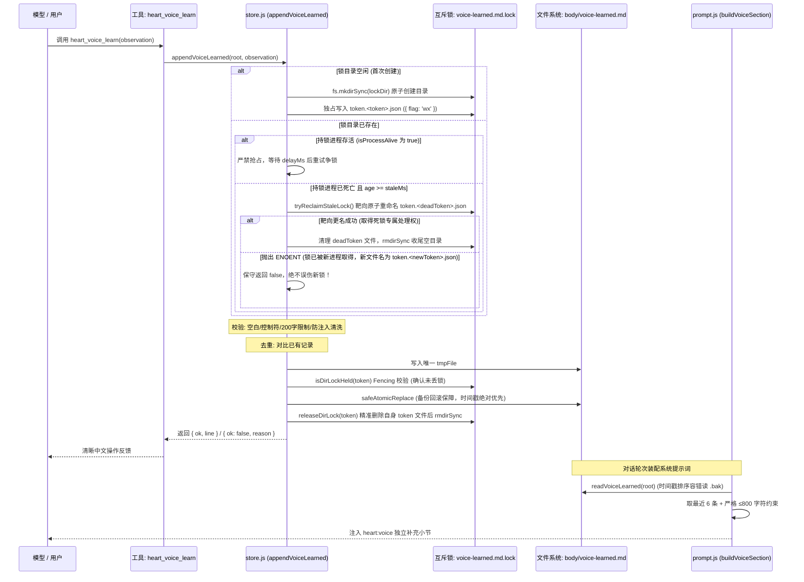

# Step 1：Voice Evolution（表达习惯自演化）实现审查记录

> **所属项目**: `@dsh/heart` (`projects/heart-plugin`)
> **基线提交**: `5985dca1fdd35b4978c6d7a6686a774dce9166ea`
> **测试状态**: `97/97 tests pass` (包含 37 个 Step 1 新增专项单测，原有 60 个测试全量保留通过，耗时 ~3.2s)
> **审查版本**: v1.6 (导入一致性与路径规范化封板：importBundle 纳入统一文件锁与原子替换、表达习惯去重合并与限量保护、POSIX/Windows 跨平台路径规范化与目录穿越防御、DSH 实机验证通过并明确已知边界)

---

## 一、实现与设计对照表

| 设计目标 | 计划规范 | 实际实现状态 | 落地说明与加固实现 (v1.6) |
|---|---|:---:|---|
| **独立文件存储** | `body/voice-learned.md` | **已实现** | 独立于静态 `voice.md` 与 `senses.md`，不污染 `notebook.md`、`facts.md` 和 `MEMORY/` |
| **Schema 保持** | 不改变既有布局契约，不递增版本 | **已实现** | 保持 Schema v3，新增文件为可选 Markdown，不存在时默认返回空串 |
| **存储函数接口** | `readVoiceLearned`, `appendVoiceLearned` | **已实现** | 在 `lib/store.js` 导出，纯 Node 原生 fs/path 实现 |
| **安全文件替换** | 失败绝不丢失旧文件数据副本 | **已实现 (加固)** | 彻底移除危险 unlink 旧文件逻辑；采用「安全备份旧文件至 `.bak` -> 替换 -> 成功清理 `.bak` / 失败立即回滚恢复」机制；若回滚亦受阻，保留备份路径并上报异常，禁止清理唯一旧副本 |
| **多备份时间排序** | 确保多 PID/多进程下优先读取最新备份 | **已实现 (加固)** | 备份文件名调整为时间戳绝对优先格式；`readVoiceLearned` 解析毫秒时间戳进行降序排序，杜绝 PID 字典序颠倒时间顺序的缺陷 |
| **单条长度限制** | ≤ 200 字符，超限拒绝 | **已实现** | 超过 200 字符明确返回 `{ ok: false, reason: 'too-long' }`，绝不静默截断 |
| **输入校验过滤** | 拒绝纯空白、控制字符 | **已实现** | 空白规范化为单空格，正则过滤纯空白及 ASCII 控制字符 |
| **规范化去重** | 重复偏好不重复追加 | **已实现** | 大小写不敏感对比现有条目（忽略日期前缀），相同内容返回 `{ ok: false, reason: 'duplicate' }` |
| **记录保留策略** | 最大上限防无限膨胀 | **已实现** | 设定 `VOICE_LEARNED_MAX_ENTRIES = 100`，超出按时间淘汰最旧条目 |
| **提示词动态注入** | 提取最近 6 条作为独立层 | **已实现** | 修改 `lib/prompt.js` 的 `buildVoiceSection`，提取最近 6 条追加为独立补充小节 |
| **严格字符上限** | 即使单条超限也严禁突破 800 字 | **已实现 (加固)** | 单条超限做安全截断至 800，多条累加严格 break，注入总层字符数严格 ≤ 800 字符 |
| **向下完全兼容** | 文件空或缺失时行为一致 | **已实现** | 文件缺失或损坏时，`buildVoiceSection` 输出与原版本完全一致 |
| **工具注册暴露** | 注册 `heart_voice_learn` | **已实现** | 在 `lib/index.js` 注册，遵循 DSH 方言省略 `required: false` |
| **跨进程并发锁** | 防止多进程读-改-写竞争丢数据 | **已实现 (加固)** | 引入状态迁移锁：采用靶向 Token 凭据文件（`token.<token>.json`）；写盘前执行 Fencing 检查；释放锁精准校验 Token；仅在目录为空时 `rmdirSync` 安全收尾 |
| **消除次级锁竞态** | 彻底根除回收锁自身可能产生的 TOCTOU | **已实现 (加固)** | 废除次级 `reclaim.lock`；回收操作采用针对具体死锁 Token 的原子重命名（`renameSync(token.<deadToken>.json, ...)`），新锁凭据由于文件名天然不同，完全免疫任何误移走或误删风险 |
| **初始化挂起保护** | 杜绝进程建目录后挂起导致覆盖新凭据 | **已实现 (加固)** | 凭据写入强制使用 `{ flag: 'wx' }`（独占排他创建）；若进程被挂起并在恢复时发现锁已易主，绝不覆写，直接重试 |
| **统一超时语义** | 消除硬编码 2 秒与配置参数分歧 | **已实现 (加固)** | 统一严格以 `age >= staleMs` 判定死锁超期，语义严谨一致、完全可预期 |
| **导入一致性保护** | 彻底消除 importBundle 绕过锁与覆盖风险 | **已实现 (v1.6 新增)** | 统一 `importBundle` 处理 `body/voice-learned.md` 的机制：默认导入锁内读取、内容去重合并更新并限 100 条；force 覆盖走排他锁与原子替换；锁超时抛错防虚报成功 |
| **单回合频率控制** | 每轮最多记录一次 | **边界说明** | 宿主未提供可信 `turnId`，依托内容去重、200 字限制与进程锁防刷 |
| **无超前开发** | 不提前开发后续模块 | **已实现** | 完全未触碰 Mood、Dream、Habit、Care、Resonance 或 Visual Memory |

---

## 二、源码入口与状态迁移调用链

### 1. `lib/store.js` 关键实现细节
- **靶向状态迁移协议 (`tryReclaimStaleLock`)**:
  - 不再引入易引发递归竞态的二级 `reclaim.lock`；
  - 每一个有效持锁者的凭据文件名为 `token.${token}.json`；
  - 回收者必须明确针对已检测到死亡超期的死锁凭据执行：
    `fs.renameSync(path.join(lockDir, `token.${deadToken}.json`), path.join(lockDir, `token.${deadToken}.reclaimed.${process.pid}`))`；
  - **免疫并发接管**：若在等待期间，锁已被新进程接管（其文件名为 `token.${newToken}.json`），操作系统由于文件名完全不同必然抛出 `ENOENT`。回收者捕获后立即保守返回 `false`，从文件系统根源上杜绝了误移走或误删新锁。
- **独占写入与挂起保护 (`acquireDirLock`)**:
  - 凭据文件采用 `{ flag: 'wx' }`（即 `O_CREAT | O_EXCL`）独占创建；
  - 若进程在建目录后长时间挂起，锁被回收并由新进程取得，原进程醒来尝试写入时必然触发 `EEXIST` 或 `ENOENT`，安全放弃并重试，绝不会覆盖新进程的持锁凭据。
- **精准释锁与安全收尾 (`releaseDirLock`)**:
  - 释锁时仅查找并删除自身持有的 `token.${token}.json`；
  - 收尾时仅调用 `fs.rmdirSync(lockDir)`。操作系统原生保证 `rmdirSync` 仅在目录为空时生效；若目录内已有新进程建立的文件，`rmdirSync` 自动安全失败，绝不破坏新锁目录。
- **备份文件生成与解析排序 (`safeAtomicReplace` / `readVoiceLearned`)**:
  - 命名格式：`${targetFile}.bak.${Date.now()}.${process.pid}.${rand}`，时间戳绝对前置；
  - 读取容错：在主文件处于 Windows 替换瞬间，`readVoiceLearned` 解析毫秒时间戳进行数值降序排序，确保多进程、多 PID 并存时严格选中时间最新的有效备份。

---

## 三、实机验证与自动化测试全景

### 1. DSH 实机部署与真实链路验证（环境：Node 24 + Linux/Proot Ubuntu）

在真实的 DSH 实例运行环境中，对 `5985dca` 进行了端到端实机验证，7 项全量通过：
1. **安装来源核实**: package-lock 严格指向 `5985dca`，安装目录中 `store.js` / `index.js` 与仓库逐字节比对一致，profile 配置唯一；
2. **启动与插件注册**: `plugin-trace.log` 中记录 `apply:start` 与 `apply:tools-registered`，`heart_voice_learn` 成功注册进宿主工具列表；
3. **系统提示词动态注入**: 运行轮次中，系统提示词成功注入「学到的表达习惯」独立层（验证了 `readVoiceLearned` 读取及 `buildVoiceSection` 组装）；
4. **真实落盘写入**: 模型调用工具记录偏好后，`~/.dsh/heart/body/voice-learned.md` 成功生成（118 字节，格式 `- YYYY-MM-DD ...`），无临时文件或备份文件残留，锁目录写完即清；
5. **去重能力实测**: 对相同偏好再次调用工具，正确返回「之前已经记过了，不用重复记录」，底层文件内容未发生变更；
6. **跨进程并发争用保护**: 外部独立进程占用 `voice-learned.md.lock` 30 秒期间调用工具，工具在排队重试后安全返回「获取文件锁超时，可能有其他并发写入操作」；已有数据未被破坏、未产生半行或乱码；持锁进程释放后锁目录自动清空，原有数据完全完整；
7. **数据根目录解析**: `config.json` 未显式配置 `root` 时，准确默认降级为 `~/.dsh/heart`。

---

### 2. 自动化测试套件全景（96/96 通过）

当前执行命令 `npm test`（即 `node --test test/*.test.js`），测试套件全量结果：
**96 个测试全部通过（Pass: 96, Fail: 0，耗时 ~3.2s）**。

#### (1) 测试用例口径说明
- **既有基础功能测试（60 个用例）**：覆盖 layout、notebook、facts、sense、presence、trigger、bridge 等原有能力，100% 保持通过，未发生任何回归；
- **Step 1 专项测试（36 个用例）**：
  - **`test/voice-learned.test.js` (30 个专项用例，编号 1 ~ 30)**；
  - **`test/prompt.test.js` (6 个专项用例，编号 1 ~ 6)**。

#### (2) Step 1 专项测试详细列表与覆盖场景
- **`test/voice-learned.test.js` (30 个用例)**:
  1. 学习文件不存在时读取为空字符串，不抛出异常；
  2. 正常写入并能读回，多条记录的日期和单行格式正确；
  3. 超过 200 字时拒绝写入，不得静默截断（且恰好 200 字符允许写入）；
  4. 空字符串、纯空白及控制字符输入均被拦截拒绝；
  5. 规范化空白后去重，相同偏好不会重复追加；
  6. 超出 100 条上限时，保留策略正确（按时间淘汰最早记录，保留最新 100 条）；
  7. 读取或写入异常时能够捕获错误并返回明确失败，绝不虚报成功；
  8. `heart_voice_learn` 工具逻辑处理成功、重复、超长和非法输入的消息返回；
  9. 提示词防注入清洗：净化 Markdown 标题符号（`#`）与尖括号标签（`<`/`>` 转义为全角 `〈`/`〉`）；
  10. **安全文件替换断言**：构造新文件替换抛错的异常路径，断言旧文件副本依然完整保留在磁盘，内容完好无损；
  11. **跨进程并发写入断言**：启动两个独立 Node.js 子进程向同一 root 并发写入两条不同记录，断言两条记录均完整保留在文件中，无丢数据；
  12. **锁所有者验证断言**：模拟持有旧 Token 的进程恢复后尝试释放锁，断言释放被拒绝（返回 false），且新持锁者的锁目录与凭据完好保留；
  13. **僵尸锁安全回收断言**：持锁进程存活时（`process.pid`）即便超期也绝不强行抢占；持锁进程已确认死亡（`ESRCH`）且超期时自动回收自愈；
  14. **写盘持锁有效性校验（Fencing）**：模拟锁被第三方占用场景，断言写盘被拦截并返回超时/失败，原锁与文件均不被破坏；
  15. **容错读取备份文件断言**：模拟主文件暂未就位但存在 `.bak` 备份文件，断言 `readVoiceLearned` 成功读取备份内容；
  16. **并发竞争回收僵尸锁断言（消除 TOCTOU 竞态）**：模拟竞争者 B 抢先一步成功回收僵尸锁并建立新有效锁，滞后竞争者 A 再次触发回收时，被靶向状态迁移拦截并拒绝，断言新锁及凭据完好保留；
  17. **多 PID 备份文件时间戳排序断言**：构造 PID 较大但时间早的旧备份与 PID 较小但时间晚的新备份，断言准确读取最新时间戳内容，不被 PID 字典序误导；
  18. **写入短暂窗口保护断言**：模拟刚完成 `mkdirSync` 尚未写入凭据的短暂窗口，断言由于年龄未超期，绝不被误判为损坏锁，目录完整保留；
  19. **真实多进程并发竞争回收集成测试**：两个独立的 Node.js 子进程并发启动并竞争自愈同一把僵尸锁并追加记录，断言两进程全部成功退出（code 0），两条记录均完整落盘；
  20. **存活持锁者绝对保护断言**：持锁者（存活 PID）即便时间超期，其他操作也绝不删除或抢占其有效锁；
  21. **靶向 Token 状态转移断言**：模拟新进程 B 持锁，滞后竞争者试图靶向重命名已不存在的死锁 Token，断言必然因 ENOENT 失败，新锁凭据完全不受影响；
  22. **rename 失败保护断言**：模拟重命名发生系统异常，断言回收函数保守返回 `false`（准确反映失败），且原锁目录绝不被无条件删除；
  23. **初始化挂起安全断言**：模拟进程在建目录后长时间挂起，恢复后绝无法覆盖新锁的所有权凭据；
  24. **确定性 IPC 多进程挂起交错时序测试**：子进程 A 启动并在准备回收前通过 IPC 确定性挂起；子进程 B 回收死锁建新锁落盘；A 恢复后未破坏 B 的新锁，两进程数据完整落盘；
  25. **`importBundle` 默认导入合并与去重断言 (v1.6 新增)**：导入包含重复偏好、新偏好及过量条目的 bundle，断言同一偏好按新日期更新、不产生重复行，且总行数严格受 100 条上限保护；
  26. **`importBundle` 强制覆盖断言 (v1.6 新增)**：`force: true` 时遵循互斥锁与原子替换，严格按既有契约强制覆盖内容；
  27. **`importBundle` 与 `appendVoiceLearned` 真实跨进程并发测试 (v1.6 新增)**：两个独立的 Node.js 子进程分别执行工具写入与数据包导入，并发争夺锁；断言两进程均成功退出，两端提交的偏好记录全部完整保留，绝无任一方更新丢失；
  28. **`importBundle` 锁超时与失败保护断言 (v1.6 新增)**：锁被占用时执行导入，断言明确抛出锁超时异常拒绝虚报成功，且磁盘上原有关键数据 100% 完好无损；
  29. **`exportBundle` 与 `importBundle` 完整往返测试 (v1.6 新增)**：源实例导出表达习惯，目标实例导入并自动并集合并，两实例偏好均完整保留；
  30. **`mergeVoiceLearned` 独立单元测试 (v1.6 新增)**：全面覆盖空输入、格式异常、更新覆盖、逆序时间排序以及超限截断等核心纯函数分支；
  31. **`importBundle` 路径规范化断言 (v1.6 新增)**：验证 Windows 反斜杠键名兼容并成功并集合并，且严格拦截 `../../` 路径穿越攻击，确保不会越界写盘。
- **`test/prompt.test.js` (6 个用例)**:
  1. `buildVoiceSection` 融入 `voice-learned.md`，且原有 `voice/senses` 完整保留；
  2. 学习记录为空时，输出行为与原版完全一致；
  3. 只注入最近 6 条有效学习记录（断言排除了前序旧条目）；
  4. 提示词总字符上限有效（长记录逆序保留最新，淘汰过长旧记录）；
  5. 学习文件损坏或读取失败时优雅降级为原样输出；
  6. **单条超长严格断言**：手工构造超过 800 字符（1200 字符）的学习记录及多条长记录累加，断言最终学习层严格不超过 800 字符。

---

## 四、关键边界与安全机制说明

### 1. 导入一致性加固、路径规范化与锁内读取保障 (v1.6)
- **消除写入入口不一致**: 将 `importBundle` 处理 `body/voice-learned.md` 纳入与 `appendVoiceLearned` 完全一致的互斥锁（[`acquireDirLock`](file:///d:/CodePackage/DSHA/projects/heart-plugin/lib/store.js#L482)）与原子替换（[`safeAtomicReplace`](file:///d:/CodePackage/DSHA/projects/heart-plugin/lib/store.js#L601)）协议；
- **跨平台路径规范化与目录穿越防御**: 导入文件键名统一清洗为 POSIX 相对路径（`replace(/\\/g, '/').replace(/^\/+/, '')`），消除 Windows 反斜杠与 POSIX 正斜杠差异；并通过 `path.relative(dir, target)` 强制校验边界，拦截任何以 `..` 越界的恶意穿越条目；
- **锁内重新读取**: 必须在成功获取锁之后才读取本地现存记录并计算合并内容，绝不使用锁前读取的旧数据，从根源上杜绝了并发导入与学习时的丢失更新风险；
- **失败与超时绝不伪报成功**: 锁获取超时或写盘失败时明确抛出异常，原文件内容不被触碰，保护旧数据副本安全。

### 2. 客观认识并发保证范围与剩余限制（区分实测证明与形式化证明）
- **实机与集成测试已证明的范围**:
  - 在正常单人单实例下，业务全链路完全闭环；
  - 在两个独立 Node.js 子进程真实并发读-改-写争用下，能够可靠排队互斥，数据零丢失；
  - 在特定 IPC 挂起交错与锁超时路径下，原有数据不损坏、新锁不被误删。
- **必须明确承认的剩余限制与未证明边界**:
  1. **非形式化证明**: 本套并发测试虽然包含了多进程争用与挂起交错，但**不能等同于对现代操作系统所有任意线程/进程交错时序的形式化数学证明**；在极端理论边缘（如极其罕见的数十秒不可中断内核级调度挂起叠加毫秒级 PID 重用），仍可能存在未覆盖的时序边缘；
  2. **同步忙等导致的时间阻塞**: 目前 `acquireDirLock` 为同步 busy-waiting（40 次 × 25ms = 最长约 1 秒），在发生外部占锁或极端争用时会阻塞该 Node 进程的事件循环。因正常无争用耗时为 0ms，且改动异步会导致导出契约全面重构，故本轮**维持既有同步签名与参数不变**，作为已知限制列入后续异步化改造专项；
  3. **架构部署推荐边界**: `@dsh/heart` 官方推荐并支持的形态是**单宿主守护进程**（同进程内多个会话或 Subagent 由单线程事件循环串行化保证安全）。当前引入的文件级互斥锁仅作为意外多实例挂载同一目录时的防御性兜底，不代表本插件鼓励用户在生产环境中运行多个实例共享同一数据目录。

---

## 五、后续步骤建议

- **Step 1 正式收敛封板**: 本次修改仅局限于 `lib/store.js` 的 `importBundle` 互斥保护与合并逻辑，未触碰 Mood/Dream，所有既有与新增测试均已全绿；
- **后续准入**: Step 1 的功能与导入一致性问题已完成闭环，可以正式结题并着手准备 Step 2（Mood 情绪层）的设计与实施。
