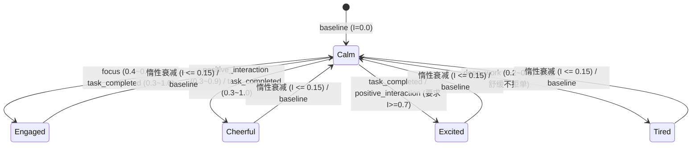

# Step 2：Mood（情绪感知层）实现审查记录

> **所属项目**: `@dsh/heart` (`projects/heart-plugin`)
> **测试状态**: `113/113 tests pass` (包含 16 个 Step 2 新增专项单测，既有 97 个测试 100% 保持通过，耗时 ~4.8s)
> **审查版本**: v1.1 (补齐持久化数据统一严格校验 isValidPersistedMood、超界与损坏现场保留、deep_work 状态矩阵收敛至仅 tired)

---

## 一、实现与设计对照表

| 设计目标 | 计划规范 | 实际实现状态 | 落地说明与约束保障 |
|---|---|:---:|---|
| **独立模块架构** | `lib/mood.js` 独立实现 | **已实现** | 新建独立模块，避免向 `store.js` 堆叠状态机，导出高内聚纯函数与存储接口 |
| **5 种离散状态** | calm, engaged, cheerful, excited, tired | **已实现** | 纯离散状态 + 单一浮点强度（0.0 ~ 1.0），首版不引入复杂向量 PAD 模型 |
| **calm 规范化** | calm 状态强度规范化为 0.0 | **已实现** | 彻底消除 `calm + 0.4` 等语义冲突数据，基准状态强度严格恒为 0.0 |
| **持久化严格校验** | `isValidPersistedMood` 统一纯函数校验 | **已实现** | 强度严格限制在 `[0.0, 1.0]`，`updatedAt` 必须为有效时间戳；`readMood` 与 `getEffectiveMood` 共享校验 |
| **状态原因映射** | State-Reason 约束矩阵拦截非法跳转 | **已实现** | 严格定义 5 类 reason 允许触发的 state 与强度区间，无有效依据严禁跳转活跃状态 |
| **deep_work 语义收敛** | 严禁凭空臆测疲劳，消除与 calm 矛盾 | **已实现** | `deep_work` 严格收敛为仅允许 `tired`（0.2~0.6），表达舒缓不拒单；回归 `calm` 交由自然衰减或显式 `baseline` |
| **惰性指数衰减** | 读时按时间戳衰减，无后台写盘定时器 | **已实现** | 公式 $I(t) = I_0 \cdot 2^{-\Delta t / H}$，默认半衰期 2 小时；低于 0.15 阈值自动回归 calm |
| **时钟倒退防御** | 负时间差绝不放大强度 | **已实现** | $\Delta t = \max(0, \text{now} - \text{updatedAt})$，系统后拨时间差按 0 处理 |
| **微小变化抑制** | 基于当前【有效状态】对比 | **已实现** | 同状态、同原因且与衰减后的有效强度变化 $< 0.05$ 时不写盘，防止抑制衰减后的新事件 |
| **存储安全机制** | 复用目录锁与 `safeAtomicReplace` | **已实现** | 读写走 `body/mood.json.lock`；重置与更新同走互斥锁；写入临时文件 + Fencing 校验 + 原子替换 |
| **损坏文件保护** | 损坏只读回退，绝不自动覆写现场 | **已实现** | `readMood` 遇损坏 JSON、非法版本或超界字段时在内存返回默认 baseline，磁盘现场 100% 留存 |
| **返回语义契约** | 明确区分业务拒绝、锁超时与真实异常 | **已实现** | 业务拒绝/无显著变化返回 `{ ok: false, reason }`；锁超时返回 `lock-timeout`；存储 I/O 故障抛错 |
| **低侵入提示词** | order 52，低于阈值静默，无自由文本 | **已实现** | 仅输出预定义建议；严禁注入 `reason`、模型思考或用户文本；`calm` 或 $\le 0.15$ 时返回空串 |
| **低自主性红线** | 零额外 LLM 调用、零主动通知、零记忆写入 | **已实现** | 无独立模型请求；无 `setInterval`；不写入 `notebook.md`/`facts.md`；不触碰 Dream |

---

## 二、状态转移与 Reason 映射矩阵

### 严格约束规则表
- **`baseline`**: 仅允许目标为 `calm`（强度恒为 0.0）。严禁作为随意跳转其他活跃状态的通行证；
- **`task_completed`**: 允许目标为 `engaged`, `cheerful`, `excited`。常规完成使用 `engaged`/`cheerful`；只有重大成果允许 `excited`（强度 $\ge 0.7$）；
- **`positive_interaction`**: 允许目标为 `cheerful`, `excited`（必须有明确正面反馈证据）；
- **`focus`**: 仅允许目标为 `engaged`（强度 0.4 ~ 0.9），代表推进任务的专注节奏；
- **`deep_work`**: 仅允许目标为 `tired`（强度 0.2 ~ 0.6）。**严禁以沉默、夜间时间或单纯对话轮数推断疲劳**；文案严格限定为舒缓简洁，不作为拒绝任务的理由；彻底消除 `calm` 与 `0.2~0.6` 的语义冲突。

---

## 三、测试证据与全量测试套件（113/113 通过）

全量测试执行 `npm test`（即 `node --test test/*.test.js`），测试结果：
**113 个测试全部通过（Pass: 113, Fail: 0，耗时 ~4.8s）**。

### 1. 测试用例分布口径
- **既有基础功能测试（60 个用例）**：覆盖 layout、notebook、facts、memory、sense、bridge、trigger 等，100% 通过；
- **Step 1 Voice Evolution 专项测试（31 个用例）**：`test/voice-learned.test.js` 编号 1 ~ 31 全部通过；
- **Prompt 装配测试（6 个用例）**：`test/prompt.test.js` 全部通过；
- **Step 2 Mood 专项测试（16 个用例）**：`test/mood.test.js` 编号 1 ~ 16 全部通过。

### 2. Step 2 专项测试详细覆盖场景
1. **纯数学衰减精度测试**: 验证 1 个半衰期精准折半（0.8 $\rightarrow$ 0.4），2 个半衰期折半再折半（0.8 $\rightarrow$ 0.2），负时间差强制按 0 处理；
2. **惰性有效状态计算与阈值回归**: 验证衰减过程中状态保持，衰减至 $\le 0.15$ 阈值时自动回归 `calm`（强度规范化为 0）；验证 `calm` 初始脏强度强制归零；
3. **候选状态基础类型与范围校验**: 验证 5 种合法状态，拒绝非法状态（`angry`, `sad`），拒绝超界/负数/NaN 强度，拒绝未知原因；
4. **状态转移与 Reason 映射矩阵约束**: 验证 `baseline` $\rightarrow$ `excited` 被拒，`focus` $\rightarrow$ `cheerful` 被拒，`task_completed` 细分强度不足被拒，微小变化（$< 0.05$）被拒，`deep_work` $\rightarrow$ `calm` 被拒（消除语义矛盾）；
5. **有效状态对比测试**: 证明微小变化抑制基于【衰减后当前有效状态】而非磁盘历史存储值，历史高值衰减后新事件依然能正常响应；
6. **缺失文件读取安全测试**: 文件不存在时安全返回默认 `calm`，不抛出异常；
7. **正常更新、读回与重置测试**: 验证落盘合法 JSON，`updateMood` 与 `resetMood` 数据闭环；
8. **损坏文件只读回退保护测试**: 构造破损 JSON，断言安全回退至默认 `calm`，且**磁盘上的破损内容原封不动保留，绝不私自覆盖现场**；
9. **锁超时与原文件保护测试**: 外部占锁时，`updateMood` 与 `resetMood` 均明确返回 `lock-timeout`，已有数据完整保留未被触碰；
10. **并发互斥与重置测试**: 真实 Node.js 子进程并发执行 `resetMood` 与 `updateMood`，断言互斥串行化，文件无撕裂损坏；
11. **提示词严格纯净隔离测试**: 断言 `reason`、模型思考过程、数值强度等内部信息绝不泄露进提示词；低强度（$\le 0.15$）返回空串；tired 包含不作为拒单理由声明；
12. **提示词装配集成测试**: 默认无文件返回空串，正常更新后注入，文件损坏时优雅降级返回空串；
13. **`heart_mood` 工具执行层全链路测试**: 覆盖成功更新、参数类型兼容、映射约束拒绝、无显著变化拦截、锁超时提示、存储路径异常反馈；
14. **低自主性静态断言**: 检查 `lib/mood.js` 代码中零 `setInterval`、零 `setTimeout`、零长期记忆写入、零主动消息触发；
15. **`isValidPersistedMood` 纯函数边界验证**: 覆盖合法记录、非对象/数组、非法 schemaVersion、非法 state 枚举、超界/负数/NaN 强度、非法 reason、空/缺失/非合法时间戳等全场景；
16. **持久化超界强度或非法时间戳容错与现场保留**: 覆盖 `intensity: 10.0`、`intensity: -0.5`、缺失 `updatedAt`、非法时间戳字符串（`'not-a-valid-date'`）；断言 `readMood` 与 `getEffectiveMood` 均安全回退至默认 `calm`，且**磁盘上的损坏原文件未发生任何覆写修改**。

---

## 四、安全与架构边界说明

1. **零额外 LLM 请求保证**:
   - Mood 不使用独立的大模型请求，不维护后台情绪代理；
   - 依赖主会话已有上下文中的事实证据，模型在同一回合通过 Tool Call 提交更新；
2. **存储互斥与安全替换**:
   - 严格复用经过实机验证的目录锁（`acquireDirLock` / `releaseDirLock`）与原子替换（`safeAtomicReplace`）；
   - 更新与重置走同一套加锁路径，不存在后门或无锁裸写；
3. **无后台定时器写盘**:
   - 衰减全部在读时（`readMood` 或提示词装配时）依据时间戳进行纯内存惰性计算；
   - 无事件发生时，后台写盘 I/O 为零。
