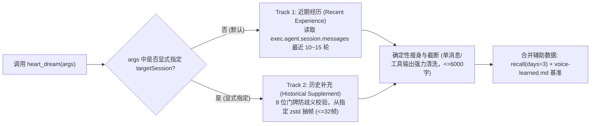
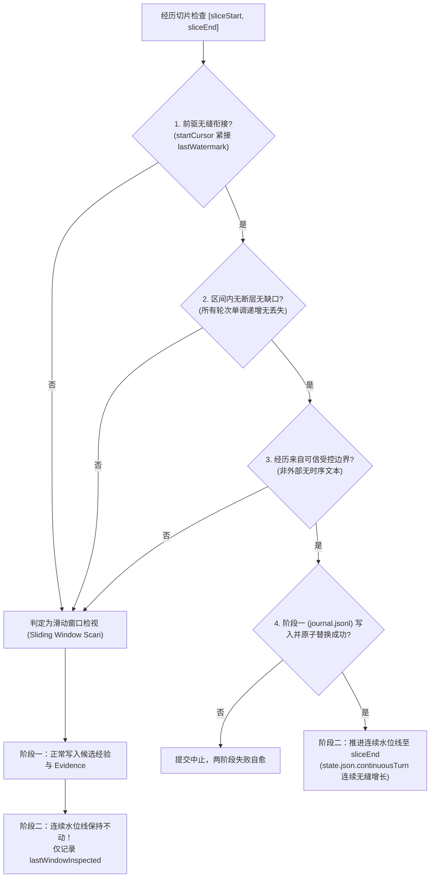
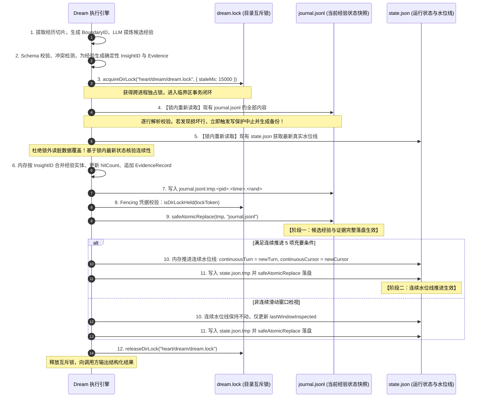

# DSH Heart Step 3A：Dream（离线经验沉淀与成长层）设计与代码审计规范

> **所属项目**: `@dsh/heart` (`projects/heart-plugin`)  
> **基线版本**: `0.15.3` (最新提交: `cf51b63`)  
> **阶段定位**: **Step 3A 最终封板设计与审计契约**（根据最后一轮专家复审意见严格修订，契约深度闭环，不修改业务代码，不启动 Step 3B 编码）  
> **核心原则**: 先理解现有系统，再确定最小可行设计；先人工显式验证经验质量，再逐步探索受控自动化；绝不引入无监督自主重写人格的黑盒代理。

---

## 一、当前源码审计结论

本次审计严格基于本地真实仓库代码（`d:\CodePackage\DSHA\projects\heart-plugin`，Git HEAD `cf51b63`，113/113 项自动化测试全绿）与真实运行环境（`C:\Users\xuaner\.dsh`）展开。

审计结论明确区分**已由源码证实的事实**、**由源码推导出的设计判断**与**未证实假设**：

### 1. 已由源码证实的事实 (Verified Facts)
- **事实 1.1（插件入口与装配管道）**：
  - 插件入口位于 `lib/index.js`，通过 Cordis 生命周期钩子 `apply(ctx, config)` 进行装配；
  - 依赖注入服务为 `inject = ['tools', 'webServer', 'agents', 'systemPrompt']`；
  - 系统提示词通过 `ctx.systemPrompt.section` 挂载三个有序分节：`heart:voice` (order 50)、`heart:mood` (order 52)、`heart:self` (order 55)；
  - 所有工具均通过 `defineTool({ name, description, parameters, output, execute })` 注册，输出统一封装为 `textOutput`（`{ message }` 纯文本渲染格式）。
- **事实 1.2（存储与并发保护机制）**：
  - 存储核心位于 `lib/store.js`（零 DSH 宿主依赖），数据根目录解析为 `resolveRoot(config.root)`（默认 `~/.dsh/heart`）；
  - 跨进程互斥锁采用目录原子创建（`fs.mkdirSync`）的 `acquireDirLock` 与 `releaseDirLock`，具备专属随机 Token、Fencing 凭据校验、基于 `isProcessAlive(pid)` 的进程存活检测、以及靶向 Token 状态迁移的防 TOCTOU 竞态僵尸锁自愈机制（`tryReclaimStaleLock`）；
  - 写盘操作复用 `safeAtomicReplace(tmpFile, targetFile)`，采用“独立临时文件（带 pid/时间戳/随机数）+ 校验锁有效性 + 重试原子替换 + 失败旧版回滚”的安全范式；
  - 损坏数据遵循**只读安全降级与现场 100% 留存原则**（`readMood` 遇损坏 JSON 只在内存回退 baseline，绝不覆写破坏磁盘现场）。
- **事实 1.3（既有三层记忆模型）**：
  - 本子层（`notebook.md`）：自我准则与边界，`appendNotebook` / `reviseNotebook` / `discardNotebook`，系统提示词默认注入最近 6 条；
  - 事实层（`facts.md`）：关于世界与对方的稳定事实，`appendFact` / `reviseFact` / `discardFact`，系统提示词默认注入最近 12 条；
  - 情节层（`MEMORY/YYYY-MM-DD.<device>.md`）：历史事件日志，按设备分文件，单行格式 `- HH:MM [device] text · src:<src> via:<via>`，只追加不就地改写，支持 `shortSessionId` 8位门牌记录与 `recall(query, { days, via })` 关键词过滤检索。
- **事实 1.4（Step 1 与 Step 2 现状）**：
  - **Voice Evolution**：记录于 `body/voice-learned.md`，上限 100 条 FIFO 淘汰，提示词注入逆序最近 6 条、总字数上限 800 字，含防注入标签清洗；
  - **Mood**：状态机位于 `lib/mood.js`，离散状态 `['calm', 'engaged', 'cheerful', 'excited', 'tired']`，`calm` 强度严格规范化为 0.0；通过 `STATE_REASON_MATRIX` 约束 5 类触发原因（`deep_work` 严格限定为 `tired`）；惰性指数衰减（半衰期 2h，$\le 0.15$ 阈值归零回归 calm），时钟倒退防御与微小变化抑制（$< 0.05$ 拦截）；`isValidPersistedMood` 统一严格校验。
- **事实 1.5（调度与触发机制）**：
  - 心跳位于 `applyPulse`（`lib/index.js`），采用进程级 `setInterval`（默认 60s 步长）；
  - 感知层（`lib/sense.js`）采样用户活跃度与系统空闲时间（`sense.json` / `sense.log`）；
  - 触发层（`lib/trigger.js`）支持回席触发（`shouldTriggerReturned`）与空闲自主回合（`shouldTriggerIdle`），包含安静时段拦截（`inQuietHours`，默认 23:00–08:00）、触发冷却（`triggerCooldownMinutes`，默认 360m）、每日限额（`idleTurnDailyCap`）与分品类配额管理（`idleCategories`）；
  - 会话查找（`lib/target.js`）通过扫描会话文件最新 `mtime` 精准锁定活动窗口，平局时安全放弃（返回 null），绝不盲目回退到历史老会话。

### 2. 由源码推导出的设计判断 (Design Inferences)
- **判断 2.1**：现有 `MEMORY/*.md` 的记录密度无法单独支撑深度的经验沉淀。在真实运行环境下，`MEMORY` 依赖模型或用户主动调用 `heart_write(kind='memory')`，每天仅产出 1~3 条摘要，大量交互细节（如代码调试路径、用户对输出格式的微调要求、摩擦纠偏）均流失在会话流中。
- **判断 2.2**：宿主原始会话文件（`session.v4.jsonl.zstd`）虽然完整，但直接全量解析成本极高（真实单个会话压缩包达 540KB+，包含 600+ 帧，展开后有庞大的工具调用结果与中间状态）。必须在摄取前进行**严格的边界裁剪、帧过滤与增量水位线控制**，否则必然导致 Token 爆炸与性能卡顿。
- **判断 2.3**：Dream 的经验必须经过分级（原始经历 $\rightarrow$ 候选经验 $\rightarrow$ 已确认经验 $\rightarrow$ 待确认假设）。如果允许模型单次反思直接覆盖写入 `facts.md` 或 `notebook.md`，极易因模型单次“幻觉”或“过度概括”而永久污染自我准则与长期记忆。

### 3. 未证实假设 (Unconfirmed Hypotheses)
- **假设 3.1（宿主多实例并发写入边界）**：当前未知在多实例并行或桌面宿主异常闪退时，底层 `session.v4.jsonl.zstd` 是否可能存在尾帧写入不完整的情况（目前代码中 `try/catch` 忽略了解压损坏帧，但未实测极端坏帧恢复率）。
- **假设 3.2（Token 额度敏感度）**：当前未知用户运行宿主大模型时的上下文窗口上限与计费承受力。设计中应假设“Token 极度珍贵”，按最严苛的成本控制策略进行规划。

---

## 二、会话历史读取与解压能力的真实边界

在 Step 3A 讨论中，首要核心是搞清楚：**插件到底能稳定、安全地读取哪些会话数据？** 严禁仅凭类名或推测来构建虚幻的读取架构。

结合真实源码与宿主文件系统，我们对以下 4 个层次进行了彻底梳理：

### 1. DSH 官方正式 API (Formal Host API)
- **代码事实**：插件注入的 `ctx.agents` 服务仅提供：
  - `ctx.agents.list()`：返回当前宿主进程中正在运行或已经加载的活动 Agent 实例数组；
  - `ctx.agents.get(id)`：根据 `id` 获取某个 Agent 实例；
- **能力边界与限制**：
  - **DSH 官方并不提供“跨工作区查询历史已归档会话”的高层查询 API**。
  - 已经关闭、未加载到内存的历史会话，无法通过 `ctx.agents` 检索。

### 2. 当前请求可获得的上下文 (Request Execution Context)
- **代码事实**（见 `lib/index.js` L256, L496, L639, L645）：
  - 工具的 `execute(args, exec)` 方法在执行时，第二个参数 `exec` 携带当前调用的实时上下文；
  - `const caller = exec && exec.agent`：提供当前 Agent 实例；
  - `caller.id`：当前会话真实 UUID；
  - `caller.options.subagentDepth`：**子代理深度**。源码中明确依据 `depth === 0` 判定主会话窗口，`depth > 0` 为临时子代理；
  - `caller.session.messages`：**当前会话在内存中的最新轮次消息数组**（包含 role、content、source 等完整结构）。
- **能力结论**：在工具调用执行期间，**当前活动会话的内存切片（In-Memory Messages）是 100% 确定、零 I/O 成本且由宿主直接保证的可靠数据源**。

### 3. 底层历史会话解压规范、消息抽取与路径安全防御 (Historical zstd Specs & Security)

#### 3.1 帧上限与字符预算的双重独立硬约束 (Independent Dual Hard Caps)
> [!IMPORTANT]
> **概念澄清**：zstd 压缩帧数、JSONL 记录行数、有效对话消息数与对话轮数（Turn）是完全不同的概念。
> 32 帧（`maxFrames: 32`）与 6,000 字符（`maxChars: 6000`）是**两个独立执行的硬上限**，绝不能因清洗后字符未超限就越界解压更多帧！

- **解压层硬约束（Frame Cap）**：
  - 逆向只解压底层 `session.v4.jsonl.zstd` 尾部的最近 **32 帧**（`maxFrames: 32`），绝不全量解压；
  - 遇到未写完的尾帧抛出 `ZstdError` 时，依据 `try/catch` 自动安全 `continue`，使用前面已完整封顶的历史帧；
  - 一旦逆向解压达到 32 帧，**立即停止解压**，严格控制解压 CPU 与内存峰值。
- **记录解析与事件识别（Record Parsing）**：
  - 从解压出的 JSONL 记录中解析事件对象；
  - 仅提取有效对话消息：`type === 'user/message'` 与 `type === 'assistant/message'`；
  - 严格剔除系统内部注入消息（`time-context`, `skill-catalog`, `runtime-context` 等）。
- **消息排序与稳定时序保证（Chronological & Stable Ordering）**：
  - 优先按时间戳 `timestamp` 严格递增排序；
  - 若出现时间戳相同或缺失的情况，**严格以文件原本的行物理先后顺序（Physical Line Order）作为第二排序依据**，严禁不稳定的随机重排。
- **轮次（Turn）标准定义**：
  - 1 个有效 Turn = 1 条用户提问 + 关联的助手回复（及伴随的紧凑工具调用摘要）。
- **输入截断与字符预算（Character Budget）**：
  - 单条用户消息截断至 500 字；单条助手消息截断至 800 字；
  - 单条 `tool/result` 输出强力清洗：只保留退出码与前 150 字文本摘要，丢弃所有大型 JSON、Base64 与调用栈；
  - 无论帧数多少，单次经历切片总字符数严格硬顶 **6,000 字符**（$\approx 3,000$ Tokens），超限时从最旧轮次开始逆序裁剪。

#### 3.2 会话路径规范化、软链接防护与 8 位门牌歧义处理 (Path Traversal & Ambiguity Defense)
- **完整 UUID 强格式校验**：
  - 必须严格匹配 36 位标准 UUID 正则：`/^[0-9a-f]{8}-[0-9a-f]{4}-[0-9a-f]{4}-[0-9a-f]{4}-[0-9a-f]{12}$/i`，非法格式直接拒绝。
- **路径规范化与软链接防御（Root Traversal Defense）**：
  - 目标物理路径必须通过 `path.resolve` 规范化，并使用 `fs.realpathSync` 解除所有符号链接（symlinks）；
  - **根目录边界强制校验**：解析后的物理绝对路径必须严格以 `<DSH_HOME>/sessions/` 为前缀开头：
    `realPath.startsWith(path.resolve(dshHome, 'sessions'))`
  - 严禁通过 `..`、盘符跳转或软链接穿透访问外部敏感文件，一旦越界立即抛出 `security-path-traversal` 拒绝访问。
- **8 位门牌歧义安全报错（Doorplate Ambiguity Handling）**：
  - 当通过 8 位短门牌（如 `src:177574c3`）查找物理会话时，遍历 `<DSH_HOME>/sessions/*/<candidate>`；
  - **歧义防御规则**：
    - 若匹配项 $\ge 2$：**严禁猜测或任选其一**，必须立即中止并返回明确错误：
      ```json
      { "ok": false, "reason": "ambiguous-source", "message": "门牌 177574c3 匹配到多个历史会话，请提供完整 UUID" }
      ```
    - 若匹配项 $= 0$：返回 `{ ok: false, reason: 'session-not-found', message: '未找到指定门牌对应的历史会话' }`；
    - 若匹配项 $= 1$：提取其唯一匹配的目录，并继续执行上述 UUID 校验与根目录边界检查。

---

## 三、现有能力与缺失能力清单

| 能力维度 | 现成可用能力 (Directly Reusable) | 缺失 / 待建设能力 (Missing / Needed for Dream) |
|---|---|---|
| **并发与存储** | 1. 目录互斥锁与僵尸锁自愈<br/>2. 安全原子替换 (`safeAtomicReplace`)<br/>3. 损坏现场保留与内存降级 | 1. `heart/dream/` 专用持久化子目录<br/>2. 结构化当前经验状态快照 (`journal.jsonl`)<br/>3. 增量水位线状态存储 (`state.json`) |
| **数据源读取** | 1. 情节记忆检索 (`recall`)<br/>2. 当前有效 Mood 读取 (`readMood`)<br/>3. 既有 Voice 偏好读取 (`readVoiceLearned`)<br/>4. zstd 会话日志流式切帧解压<br/>5. `exec.agent.session.messages` 内存读取 | 1. 结构化会话轮次抽取与清洗器（过滤工具巨型输出）<br/>2. 增量经历抓取器（基于单调递增连续游标与水位线） |
| **经验提炼与校验** | 1. 正则防注入清洗<br/>2. 纯函数格式校验范式 (`isValidPersistedMood`) | 1. 候选经验结构校验器 (`validateCandidateInsight`)<br/>2. 三级 ID 体系（RunID / BoundaryID / InsightID）<br/>3. 经验实体与证据记录解耦合并器 (`mergeInsightEvidence`)<br/>4. 矛盾与冲突经验检测器 (`detectInsightConflict`) |
| **调度与触发** | 1. 进程心跳定时器 (`applyPulse`)<br/>2. 安静时段与防重复触发器<br/>3. 活动会话精准路由 (`findActiveAgent`) | 1. 显式反思与审核工具入口 (`heart_dream`)<br/>2. 反思任务专用上下文构建器（区分普通对话与复盘模式） |
| **审核闭环** | 1. `appendVoiceLearned` 写入通道<br/>2. `appendFact` / `reviseFact` 事实通道<br/>3. `appendNotebook` 自我认知通道 | 1. 严格正交审核状态流转接口 (list / show / confirm / reject / revoke)<br/>2. 确认与晋升物理隔离解耦机制 |
| **系统提示词** | 1. 分节动态装配与 order 机制<br/>2. 严格字符与行数上限截断 | 1. 长期沉淀经验的低侵入呈现策略（严防全量经验塞入普通对话上下文） |

---

## 四、数据源可用性与双轨摄取策略

### 1. 双轨输入模型 (Dual-Track Model)



- **Track 1（近期经历，默认）**：处理当前会话未反思的最新交互，以内存切片为基准，100% 稳定可靠；
- **Track 2（历史补充，显式）**：用户指定特定会话 ID 或短门牌，经唯一性校验后逆向解压不超过 32 帧，受 6,000 字独立预算保护。

---

## 五、经验模型、正交分类、三级 ID 与证据解耦 (Insight Entity vs Evidence Records)

为了保证幂等重试、追踪输入来源并杜绝滑动窗口漂移误判，首版确立清晰的**三级 ID 架构**与**两项正交分类**，并彻底解耦**经验实体**与**证据记录**：

### 1. 三级 ID 体系规范

| ID 级别 | 命名与格式 | 计算依据与构成 | 核心用途与生命周期 |
|---|---|---|---|
| **Level 1: 运行标识 (Run ID)** | `run-YYYYMMDD-HHmmss-rand6`<br/>(例: `run-20261027-193000-a1b2c3`) | 启动 Dream 时的系统时间戳 + 6位随机字符串 | 标识单次反思生命周期，贯穿单次反思的所有日志、临时文件与审计链 |
| **Level 2: 边界标识 (Boundary ID)** | `bnd-sha256(sessionId + startCursor + endCursor + turnCount).slice(0, 8)` | 会话 ID + 连续切片起始与结束稳定游标 | 严格标识**被处理的这批经历的物理边界**。窗口平移哪怕 1 轮，Boundary ID 即改变，杜绝误判 |
| **Level 3: 经验标识 (Insight ID)** | `ins-sha256(category + statement_normalized + scope).slice(0, 8)` | 分类枚举 + 规范化陈述正文 + 适用领域 | **纯内容确定性哈希**。同一核心经验在不同会话中被重复提炼时，产出相同 ID，天然用于幂等去重 |

### 2. 两个严格正交的字段：`type` 与 `status`

认识论类型（经验本质是什么）与工作流状态（处于审核流的哪一步）必须完全正交，绝不把 `hypothesis` 混入 `status`！

- **`type`（认识论分类）**：
  - `fact`：客观明确记录的事实（如“用户操作系统是 Windows 11”）
  - `observation`：多次重复发生的稳定行为特征（如“用户偏好先给方案再解释背景”）
  - `inference`：有明确上下文依据的逻辑推导（如“用户近期在重点重构存储层”）
  - `hypothesis`：证据不足、过度外推或存在冲突的假设（如“用户可能习惯深夜工作”）
- **`status`（工作流审核状态）**：
  - `candidate`：初始候选状态，待人工审核（所有新提炼条目初始均为 `candidate`，包括 `type === 'hypothesis'`）
  - `confirmed`：用户显式批准确认
  - `rejected`：用户显式驳回废弃
  - `superseded`：被后续更新的经验所替代（首版仅定义枚举，无操作入口，系统不主动设为 superseded）

### 3. 数据结构定义：经验实体与证据记录解耦

```typescript
/** 证据记录：记录单次发现该经验的完整上下文与溯源链 */
export interface EvidenceRecord {
  /** 证据唯一 ID，格式: evi-hash8 */
  evidenceId: string

  /** 产生该证据的边界 ID 与运行 ID */
  boundaryId: string
  runId: string

  /** 会话标识与轮次范围 */
  sessionId: string
  turnRange: [number, number]

  /** 证据产生的时间戳 (ISO 8601) */
  timestamp: string

  /** 紧凑对话证据摘要（截断至 150 字以内，言之有物） */
  evidenceExcerpt: string
}

/** 经验实体：由 InsightID 唯一标识的核心认知条目 */
export interface CandidateInsight {
  /** Level 3 纯内容确定性哈希 ID，天然幂等，格式: ins-hash8 */
  id: string

  /** 经验分类枚举 */
  category: 'communication' | 'workflow' | 'environment' | 'general'

  /** 经验陈述正文，单行 200 字以内，规范化去重 */
  statement: string

  /** 正交字段 1：认识论分类 */
  type: 'fact' | 'observation' | 'inference' | 'hypothesis'

  /** 正交字段 2：工作流审核状态 */
  status: 'candidate' | 'confirmed' | 'rejected' | 'superseded'

  /** 适用领域 / 作用域 (如 'code-style', 'git', 'general') */
  scope: string

  /** 初始置信度 (0.0 ~ 1.0) */
  confidence: number

  /** 累积命中次数 (初始为 1，重复提炼命中时递增) */
  hitCount: number

  /** 首次与最近一次观察到该经验的时间戳 */
  firstSeenAt: string
  lastSeenAt: string

  /** 多来源证据链（首版最多保留最近 5 条独立证据，防止条目无限膨胀） */
  evidenceList: EvidenceRecord[]

  /** 审核附言（驳回原因等） */
  statusReason?: string

  /** 潜在冲突标记 */
  conflictWith?: { targetId: string; reason: string } | null

  /** 持久化时间字段（当前条目创建与更新时间） */
  createdAt: string
  updatedAt: string
}
```

### 4. 经验去重与证据合并契约 (Deduplication & Evidence Merging Contract)

当反思提炼产出候选经验并进入临界区时，若发现已有相同 `id`（即 InsightID 重合）：
1. **实体不重复创建**：保持现有经验实体的唯一性，不产生多行冗余；
2. **累加命中计数**：`hitCount += 1`，并将 `lastSeenAt` 刷新为当前反思的时间戳；
3. **合并证据列表**：
   - 检查新提炼出的 `EvidenceRecord`；
   - 若其 `evidenceId`（或 `boundaryId`）在现有 `evidenceList` 中未出现，则追加至数组；
   - 按证据时间戳倒序排列，**保留最近 5 条完整证据**（FIFO 淘汰超期证据），确保证据链既可追溯又不无限膨胀；
4. **认识论强化规则 (Epistemological Reinforcement)**：
   - 若该条目原 `type === 'inference'` 或 `type === 'hypothesis'`，当在跨会话（来自至少 2 个不同 `sessionId`）多次独立证实且 `hitCount >= 3` 时，反思提炼引擎可在提炼结果中建议将 `type` 升级为 `observation`；
   - **核心约束**：认识论类型的强化建议**绝对不改变既有的 `status`**！若当前状态是 `confirmed` 则保持 `confirmed`，若为 `candidate` 则保持 `candidate`，严禁越权修改用户的审核决策；
5. **已驳回条目保护 (Rejected Item Guard)**：
   - 若该条目已被用户 `rejected`，系统仅追加新证据并刷新 `lastSeenAt`，**绝对不自动翻转回 candidate 或 confirmed**；已被驳回的观点除非用户显式执行 `revoke`，否则保持驳回状态。

---

## 六、水位线与窗口截断矛盾的彻底解决 (Continuous Watermark vs Sliding Window)

### 1. 矛盾本质分析
如果一个会话共有 50 轮，Dream 仅摄取了“最近 15 轮”（即第 36~50 轮）：
- 若将水位线直接推进到第 50 轮，则第 1~35 轮将被**永久跳过，形成不可挽回的历史数据黑洞**；
- 若水位线不推进，下次又会重复摄取第 36~50 轮。

### 2. 稳定消息游标定义 (Message Cursor Definition)

> [!WARNING]
> 宿主 `caller.session.messages` 的数组下标并不绝对稳定（宿主在会话超长时可能裁剪旧消息、重构数组或注入非消息结构）。
> 首版必须采用**可验证的复合消息游标（Cursor）**，而不是单纯依赖裸数组索引。

```typescript
export interface MessageCursor {
  /** 消息在数组中的物理索引 (从 0 开始) */
  index: number
  /** 宿主提供的稳定消息唯一 ID (如 uuid)；若宿主未提供，则使用 hash(role + timestamp + content.slice(0, 50)) */
  id: string
  /** 消息生成的 ISO 8601 时间戳 */
  timestamp: string
}

export interface SessionWatermark {
  /** 会话完整 UUID */
  sessionId: string
  /** 当前连续水位线游标 (最后一条连续无缺口已处理消息) */
  continuousCursor: MessageCursor
  /** 连续已处理有效轮次 (Turn Index，单调递增，无断层) */
  continuousTurn: number
  /** 最后一次滑动窗口检视记录 (用于非连续窗口检视) */
  lastWindowInspected?: {
    startCursor: MessageCursor
    endCursor: MessageCursor
    turnRange: [number, number]
    inspectedAt: string
  }
}
```

### 3. 连续推进的 5 项充要条件 (Strict Continuous Watermark Invariants)

只有**同时满足**以下 5 项条件，才允许在阶段二推进连续水位线：



1. **前驱无缝衔接 (Seamless Predecessor)**：
   切片的起始消息游标必须紧接在当前连续水位线之后（`sliceStartTurn === lastWatermark.continuousTurn + 1`），或包含前置重叠锚点（切片起始处的消息 ID 与时间戳与记录的水位线游标完全匹配）。
2. **区间内无断层无缺口 (Gap-Free Sequence)**：
   切片中包含的所有消息序列必须经过单调递增验证，无跳号、无丢失轮次、无因异常跳过的中间消息。
3. **经历来自可信受控边界 (Verifiable Boundary)**：
   经历切片必须来自当前活动会话的受控 `session.messages`，或格式严密已验证的 zstd 帧序列。外部无时序或无法证明连续性的散装文本一律禁止推进水位线。
4. **两阶段提交阶段一完成确认 (Phase 1 Confirmed)**：
   必须在 `journal.jsonl` 整文件原子替换成功且校验通过之后，才允许推进 state。
5. **缺口防御 (Gap Handling)**：
   一旦发现不满足上述任何一项条件（存在未反思的历史间隙），**一律判定为滑动窗口检视**：候选经验照常落盘（带 Evidence），**连续水位线原位绝对不动**，仅更新 `lastWindowInspected`，彻底消除历史遗漏黑洞。

---

## 七、两阶段提交、锁内读改写与损坏写保护协议 (Two-Phase Commit Protocol)

> [!CAUTION]
> **重要认知**：绝不能假设 `fs.appendFileSync` 对 JSONL 文件的追加是天然原子或安全的！
> 跨进程并发下的盲目追加会导致写撕裂（半行乱码）、操作系统缓存导致的丢行。
> 本规范要求对 `journal.jsonl` 与 `state.json` **全部采用互斥锁下的整文件安全原子替换（safeAtomicReplace）**。

### 1. 完整提交执行时序 (Step-by-Step Sequence)



#### 细化步骤说明：
1. **步骤 1：锁外预处理**
   - 提取经历切片，清洗工具输出；
   - 构造 Prompt 调用 LLM 提炼经验；
   - 纯函数校验 Schema，生成 `BoundaryID`、`InsightID` 与 `EvidenceRecord`。
2. **步骤 2：获取跨进程独占锁**
   - 调用 `acquireDirLock(path.join(dreamDir, 'dream.lock'), { staleMs: 15000, retryWaitMs: 100, maxRetries: 30 })`；
   - 超时则立即中止，返回 `{ ok: false, reason: 'lock-timeout', message: '获取 Dream 互斥锁超时，放弃写入以防冲突' }`。
3. **步骤 3：【锁内重新读取最新数据】（Re-read Inside Critical Section）**
   - **铁律**：锁外读取的任何 state/journal 仅供预估和构建 Prompt，进入临界区后**必须在锁内重新调用 `readDreamState()` 和 `readJournal()`**！
   - **防覆盖原因**：若进程 A 与 B 在锁外读取旧副本，随后依次拿锁。若后拿锁的 B 不重新读取，将用自己的快照覆盖 A 刚刚提交的修改。锁保护的是**锁内的读-改-写完整事务闭环**。
4. **步骤 4：数据合并与核对**
   - 在锁内读出的最新数据基础上，执行 InsightID 幂等去重、证据合并与认识论强化建议；
   - 对比切片起始游标与锁内最新的连续水位线，判定是否符合连续推进条件。
5. **步骤 5：阶段一（Phase 1）——整文件原子替换提交 `journal.jsonl`**
   - 序列化当前有效条目快照为 JSONL，写入专属临时文件 `journal.jsonl.tmp.<pid>.<time>.<rand>`；
   - 校验锁凭据（Fencing Check：`isDirLockHeld(lockToken)`）；
   - 执行 `safeAtomicReplace(tmp, "journal.jsonl")`；
   - 确认目标文件存在且大小符合预期。
6. **步骤 6：阶段二（Phase 2）——整文件原子替换提交 `state.json`**
   - 确认阶段一已经落盘成功；
   - 推进或保持连续水位线，更新 `lastWindowInspected`、`lastRunAt`、`lastRunId`；
   - 写入专属临时文件 `state.json.tmp.<pid>.<time>.<rand>`；
   - 校验锁凭据并执行 `safeAtomicReplace(tmp, "state.json")`。
7. **步骤 7：释放锁并返回**
   - 调用 `releaseDirLock` 释放锁；
   - 向调用方返回提炼与合并摘要。

### 2. 损坏文件写保护与现场留存策略 (Corrupted File Write-Protection)

> [!CAUTION]
> **消除设计冲突**：若读取时跳过损坏行，随后整文件原子替换写回，会导致原始损坏数据被永久抹除，违背“绝不覆写破坏现场”的原则！

本规范制定严格的**损坏文件写保护策略**：
1. **逐行严格校验**：
   `readJournal` 读取 `journal.jsonl` 时，逐行解析 JSON 并校验必填字段（`id`, `category`, `statement`, `type`, `status`）。
2. **检测到损坏行时的硬保护 (Corrupted File Write-Protection)**：
   - 只要检测到任何一行不是合法 JSON、或是被截断的半行乱码、或是缺少核心字段，**立即标记该文件为损坏状态（corrupted）**；
   - **严禁向原文件执行整文件原子覆盖**！
   - **进入只读降级模式**：任何写操作（`reflect` 写入或 `confirm`/`reject` 审核）立即被安全拦截，返回：
     ```json
     {
       "ok": false,
       "reason": "journal-corrupted",
       "message": "检测到 journal.jsonl 存在损坏行，已触发写保护以保留磁盘现场，拒绝覆写修改"
     }
     ```
   - **现场完整备份与归档**：在拦截的同时，系统自动将当前破损文件完整复制归档为 `journal.jsonl.corrupt.<timestamp>`（字节级 1:1 镜像备份，绝不删除原文件）；
   - **恢复要求**：在人工介入修复损坏行或显式执行灾难恢复前，原文件保持封存，系统自动化逻辑严禁自作主张覆盖破坏。

### 3. 故障矩阵与确定性自愈行为

| 故障发生时刻 | 现场状态 | 恢复与自愈行为 (Deterministic Recovery) |
|---|---|---|
| **LLM 抽取时超时或返回坏格式** | 锁未获取，未写任何临时文件 | 直接返回业务拒绝或抛错，磁盘零改动，下次从原位置重试 |
| **阶段一写入前锁丢失 (Fencing 失败)** | 发现 Token 被抢占或失效 | 中止操作，安全删除 `.tmp`，抛出 `lock-fencing-failed`，原数据毫发无损 |
| **阶段一原子替换失败 (EPERM 等)** | `.tmp` 残留，`journal.jsonl` 未变 | `safeAtomicReplace` 自动回滚并清理 `.tmp`，水位线未推进，下次安全重试 |
| **阶段一成功，但阶段二落盘崩溃/失败** | 候选已入库，但 `state.json` 水位线未推进 | 下次执行时，由于水位线在旧位，会再次分析该切片；但**由于 InsightID 纯内容确定性哈希与证据去重机制，系统在锁内重新读取时识别出完全相同的经验与证据 ID，直接幂等跳过重复创建，并在随后的阶段二中顺利完成水位线补齐推进**。系统天然自愈，绝不产生重复记录，也绝不破坏一致性 |
| **读取时发现既有 `journal.jsonl` 存在损坏行** | 文件中存在断电截断的半行 | `readJournal` 触发损坏硬保护，自动复制归档为 `journal.jsonl.corrupt.<timestamp>`，**拒绝一切原子覆盖写入**，磁盘原破损文件严格 100% 留存 |

---

## 八、人工审核闭环与持久化策略选型 (Review Loop Implementation)

### 1. 统一持久化数据语义命名与快照模型

> [!IMPORTANT]
> **语义统一定义**：`journal.jsonl` 的本质是**“以 JSONL 编码的当前经验状态快照（Current State Snapshot in JSONL）”**，绝非“追加状态事件日志”！
> - **单条最新状态唯一**：每个 `InsightID` 在文件中最多保留一行当前记录。
> - **整文件原子替换落盘**：无论是反思提炼新增、证据合并追加，还是人工审核修改状态，均在互斥锁内完成内存状态合并，并通过 `safeAtomicReplace` 整文件原子提交。
> - **时间戳语义**：`createdAt` 记录条目首次持久化时间，`updatedAt` 记录条目最近一次更新（或审核）时间；首版不维护冗余的事件溯源回放流。

### 2. 严格正交的审核状态合法流转表与错误行为契约

所有审核操作必须通过纯函数 `applyInsightTransition(currentInsight, action, options)` 进行确定性判定：

| 当前状态 (`status`) | 触发 action | 目标状态 (`status`) | 行为判定与返回值契约 |
|---|---|---|---|
| `candidate` | `confirm` | `confirmed` | 成功更新，`updatedAt` 刷新为当前时间 |
| `candidate` | `reject` | `rejected` | 成功更新，记录 `statusReason` 与 `updatedAt` 时间戳 |
| `confirmed` | `confirm` | `confirmed` | **幂等成功**：返回 `{ ok: true, changed: false, message: '条目已经是确认状态' }` |
| `rejected` | `reject` | `rejected` | **幂等成功**：返回 `{ ok: true, changed: false, message: '条目已经是驳回状态' }` |
| `confirmed` / `rejected` | `revoke` | `candidate` | 成功撤销审核，重新回退至待审状态，清空 `statusReason` |
| `confirmed` | `reject` | - | **非法拦截**：返回 `{ ok: false, reason: 'illegal-transition', message: '已确认条目不能直接驳回，需先 revoke' }` |
| `rejected` | `confirm` | - | **非法拦截**：返回 `{ ok: false, reason: 'illegal-transition', message: '已驳回条目不能直接确认，需先 revoke' }` |
| `superseded` | 任意审核操作 | - | **终态拦截**：返回 `{ ok: false, reason: 'terminal-status', message: '已废弃条目不允许流转' }` |

> [!IMPORTANT]
> **说明与约束**：
> 1. `type === 'hypothesis'` 的条目依然可以正常处于 `status: 'candidate'`，其审核操作遵循完全相同的规则；
> 2. `superseded` 状态在首版作为保留枚举，无前端操作入口，系统在首版不主动将任何条目设为 `superseded`；
> 3. **绝对隔离原则**：调用 `confirm` 操作**仅仅改变条目在 `journal.jsonl` 中的 status 字段**，**绝对不自动向 `voice-learned.md`、`facts.md` 或 `notebook.md` 写入任何字节**！

---

## 九、Dream 与 Voice、Mood 的职责边界与职责矩阵

| 模块 | 核心职责 | 时间尺度 | 输入源 | 状态变化规律 | 提示词注入位置 | 跨模块写权限 |
|---|---|---|---|---|---|---|
| **Voice Evolution** | 记录与对方沟通时的**表达风格与输出习惯** | 长期有效 | 显式观察到的表达偏好 | 行追加、去重、上限 100 条 FIFO | `heart:voice` (order 50)<br/>最近 6 条，$\le 800$ 字 | **只写** `body/voice-learned.md`<br/>**严禁**修改 Mood 与 Dream |
| **Mood** | 反应当前的**短期情绪倾向与能量状态** | 短期瞬态（小时级） | 即时事件（5类原因） | 惰性指数衰减（半衰期 2h），$\le 0.15$ 回归 calm | `heart:mood` (order 52)<br/>预定义文案，低于阈值静默 | **只写** `body/mood.json`<br/>**严禁**修改 Voice 与 Dream |
| **Dream** | 对历史经历进行**复盘反思、策略提炼与知识沉淀** | 周期性 / 手动批处理 | 对话历史、情节记忆、近期上下文 | 候选生成 $\rightarrow$ 校验去重 $\rightarrow$ 人工审核 | **普通对话不注入独立分节**<br/>（零额外日常 Token 膨胀） | **只写** `heart/dream/` 目录<br/>**严禁**直接裸写 Voice/Mood/Facts |

---

## 十、触发方案比较与推荐

首版严格采用 **方案 A（手动显式调用 `heart_dream`）**。

### 工具接口参数模式规范 (`heart_dream`)
```typescript
export const HeartDreamParameters = {
  action: {
    type: 'string',
    description: '操作动作: reflect（默认，提炼经历）| list（查看候选经验）| show（查看经验详情与证据）| confirm（确认经验）| reject（驳回经验）| revoke（撤销审核状态）',
  },
  id: {
    type: 'string',
    description: '经验条目 ID (show / confirm / reject / revoke 时必填，格式: ins-xxx)',
  },
  targetSession: {
    type: 'string',
    description: '可选，仅在 action=reflect 时生效。显式指定要复盘的历史会话 UUID 或 8 位短门牌；留空默认处理当前会话未反思经历',
  },
  status: {
    type: 'string',
    description: '可选，仅在 action=list 时生效。过滤状态: candidate（默认）| confirmed | rejected',
  },
  reason: {
    type: 'string',
    description: '可选，在 action=reject 时记录驳回原因',
  },
}
```

---

## 十一、Token、成本控制、隐私防御与模型输出解析规范

### 1. 输入预算严格硬上限
- 最大轮数：15 轮（30 条消息）；
- 最大字符预算：严格控制在 **6,000 字符以内**；超限逆序裁剪；
- 强力工具清洗：截断为前 150 字符摘要，过滤全部原始文件 dump 与代码堆栈。

### 2. 增量防重复
- 依赖严格的水位线，跳过已处理经历；
- 提示词中注入当前已有的 `facts` 与 `voice-learned` 单行摘要，从 Prompt 根源禁止模型重复总结。

### 3. 模型输出严格解析规范（严禁过度猜测）
- **允许的合法输入格式**：
  - 纯 JSON 文本；
  - 由标准 Markdown 代码块包裹的 JSON：` ```json ... ``` ` 或 ` ``` ... ``` `。
- **严禁过度猜测与危险修复 (No Over-Repair)**：
  - 若模型输出存在未闭合括号、语法截断、或尾部夹带无法界定的自由文本，**严禁使用宽泛正则表达式拼凑猜测字段**！
  - 若解析出的对象缺少必填字段（`category`, `statement`, `type`, `confidence`, `evidenceExcerpt`），或字段枚举不合法，**直接判定该批候选提炼失败，安全返回业务拒绝并输出诊断日志**，绝不把猜测出的畸形条目存入数据库。

### 4. 提示词零膨胀
- 普通日常对话的系统提示词（`buildPromptBundle`）完全不引入 `journal.jsonl`，普通对话消耗零增长。

---

## 十二、测试矩阵与验收标准设计

测试必须在 `projects/heart-plugin/test/dream.test.js` 中落地，严格复用已有的 Node 原生 `node:test` + `node:assert/strict` 体系，区分 4 个层级共 21 项测试：

| 测试层级 | 用例编号与测试项 | 测试输入与模拟条件 | 严格预期断言 |
|---|---|---|---|
| **一、纯函数单元测试** | `1. validateCandidateInsight` 字段完整性与边界 | 输入缺失字段、负置信度、超长文本、非法分类 | 准确拦截并返回对应错误 reason；合法对象返回 `ok: true` |
| | `2. generateInsightId` 确定性幂等哈希测试 | 输入相同分类、规范化正文、适用范围 | 多次独立计算产出的 ID 严格一致；正文微小空白差异压平后一致 |
| | `3. Boundary ID 与窗口平移测试` | 轮次变化（如 [1, 15] 变成 [2, 16]） | 计算出的 Boundary ID 必然不同，杜绝窗口平移误判 |
| | `4. detectInsightConflict` 冲突识别 | 输入与既有条目相反的断言 | 标记 `conflictWith` 且返回目标 ID，不发生隐式覆盖 |
| | `5. 8 位短门牌歧义报错与路径越界测试` | 构造 2 个具有相同前缀的不同会话目录；构造 `..` 越界路径 | 精确返回 `ambiguous-source` 与 `security-path-traversal` 错误 |
| | `6. 模型输出严格解析与坏格式拒绝测试` | 输入代码块包裹 JSON；输入截断或带多余自由文本的坏输出 | 代码块包裹正常解析；坏格式明确拒绝并记诊断，断言不猜测修复 |
| | `7. 经验实体与证据记录解耦合并测试` | 提炼相同 InsightID 但不同会话的证据 | 实体不重复创建，`hitCount` 递增，`evidenceList` 追加新证据 |
| **二、存储与锁并发测试** | `8. journal.jsonl 原子写入与读取` | 多条连续写入、追加、按 ID 检索 | 格式符合 JSONL；逐行解析无破损；写入带锁保护 |
| | `9. 两阶段提交与连续水位线推进` | 连续切片输入，模拟 journal 写入成功后推进 state | 水位线准确步进；断言 state 绝对不领先于 journal |
| | `10. 非连续滑动窗口连续水位线保持测试` | 输入跳脱历史的非连续切片（如第 40 轮） | 候选条目正常入库，**断言基础连续水位线保持原位不动** |
| | `11. 模拟中断故障自愈与幂等测试` | 模拟 journal 写入后进程退出（state 未更新），下次重试 | 相同 ID 经验被去重拦截，不重复写入 journal，水位线成功补齐推进 |
| | `12. 损坏文件写保护与现场留存测试` | 手工在 journal.jsonl 中写入非法损坏 JSON 行 | 读取安全跳过，**触发写保护拒绝整文件原子覆盖，生成 .corrupt 镜像备份** |
| | `13. 锁内重新读取防旧数据覆盖测试` | 模拟两进程锁外各持旧快照，依次排队拿锁 | 验证第二进程拿锁后必须重新读取，绝不覆盖先提交进程的条目 |
| | `14. 跨进程并发写入安全` | 启动 2 个 Node.js 子进程并发调用 Dream 存储写入 | 互斥锁生效，串行化写入，文件数据无交错损坏 |
| | `15. 锁超时安全防御` | 外部预先占用 `dream.lock` | 写入明确返回 `lock-timeout`，已有数据完整未被改写 |
| **三、审核闭环测试** | `16. 审核状态合法流转闭环` | `candidate` $\rightarrow$ `confirm` $\rightarrow$ `revoke` $\rightarrow$ `reject` | 状态准确流转；**断言 confirm 不会向 voice-learned 或 facts 写入任何字节** |
| | `17. 非法状态转换拦截测试` | 对已 rejected 的条目直接 confirm，对已 confirmed 直接 reject | 明确返回 `illegal-transition` 错误，原条目状态不变 |
| | `18. hypothesis 正交审核流转测试` | `type: 'hypothesis'` 条目在 candidate 下执行 confirm | 正常流转为 `status: 'confirmed'`，`type` 依然为 `hypothesis` |
| **四、全链路集成与安全断言** | `19. 输入截断与巨型输出清洗测试` | 构造超 20,000 字符的对话（含巨型工具 dump） | 经历自动截断至 6,000 字符，工具输出仅留摘要，正常完成提炼 |
| | `20. 运行时零后台定时器动态断言` | 在执行 `heart_dream` 期间全局 Hook `setTimeout`/`setInterval` | 断言测试运行全周期无未清理的持久后台定时器挂载 |
| | `21. 系统核心文件零改动动态哈希校验` | 在执行 reflect/confirm/reject 前后计算 facts/notebook 哈希 | 断言 `facts.md`、`notebook.md`、`voice-learned.md` 逐字节无任何修改 |

---

## 十三、Step 3B 准入标准、风险闭环与实施拆分

### 1. 准入范围定义 (Scope of Step 3B)
进入 Step 3B 编码阶段的**最小可行实现范围 (MVP)**：
1. **新建模块 `lib/dream.js`（零 DSH 宿主依赖）**：
   - 消息切片清洗与游标提取器 `filterSessionMessages(messages, options)`；
   - 候选经验 Schema 校验器 `validateCandidateInsight(candidate)`；
   - 三级 ID 生成器 `generateInsightId` / `generateBoundaryId` / `generateRunId`；
   - 经验去重与证据合并器 `mergeInsightEvidence(existingList, newCandidates)`；
   - 连续水位线校验器 `validateContinuousWatermark(sessionWatermark, sliceRange)`；
   - 两阶段原子存储管理器 `readDreamState` / `readJournal` / `commitDreamInsights(insights, boundary, options)`；
   - 审核操作纯函数与存储接口 `applyInsightTransition` / `updateInsightStatus`；
2. **在 `lib/store.js` 中统一重导出 Dream 存储接口**；
3. **在 `test/dream.test.js` 中编写并跑通上述 21 项专项测试**；
4. **在 `lib/index.js` 注册 `heart_dream` 工具（仅支持 reflect / list / show / confirm / reject / revoke）**；
5. **保持既有 113 项测试 100% 通过（总测试数达到 134+ 项）**。

### 2. 明确排除的功能 (Explicitly Excluded Non-Goals)
- ❌ **不接入 `trigger.js` 自动触发**（首版严格仅支持手动调用）；
- ❌ **不实现自动将 confirmed 经验写入 Voice 或 Facts**（首版仅维护 `journal.jsonl` 中的状态）；
- ❌ **不引入任何后台定时器或轮询任务**；
- ❌ **不实现跨工作区的全量历史后台扫描爬虫**。

### 3. 风险闭环与验证跟踪表

| 风险点 | 严重度 | 本规范中的设计闭环 | Step 3B 实施时的验证方式 |
|---|:---:|---|---|
| **水位线超前导致历史永久丢失** | 高 | 严格两阶段提交（Phase 1 journal，Phase 2 state）；连续边界 5 项充要推进条件 | 在单测中模拟阶段一成功后强杀进程，断言下次重试能够幂等推进且无历史黑洞 |
| **滑动窗口平移导致经验 ID 漂移** | 中 | 区分 BoundaryID 与 InsightID；InsightID 纯按规范化内容哈希 | 在单测中验证相同经验在不同窗口平移下生成的 InsightID 完全相同 |
| **InsightID 去重吞掉新会话证据** | 高 | 实体与证据记录解耦，命中同 ID 时累加 hitCount 并合并 EvidenceRecord | 在单测中模拟跨会话提炼同条经验，断言实体不重叠且保留多会话证据链 |
| **坏文件整文件替换抹除现场** | 严重 | 遇损坏行触发写保护拒绝原子覆盖，并自动复制生成 `.corrupt` 现场备份 | 单测构造破损行并触发写入，断言操作被拒绝且原破损文件未被覆写 |
| **锁外读脏数据导致并发覆盖** | 高 | 互斥锁内重新读取最新 journal 与 state，临界区内完成读-改-写闭环 | 单测模拟两进程锁外持旧副本并发抢锁，断言后持锁者不覆盖前持锁者条目 |
| **8 位短门牌多会话冲突与路径穿越** | 中 | 扫描发现多匹配时抛 `ambiguous-source`；realpath 强制根目录边界校验 | 构造冲突门牌与 `..` 越界路径，断言安全拦截 |
| **审核确认意外修改主记忆文件** | 高 | confirm 仅修改 `journal.jsonl` 中的 status，解耦确认与晋升 | 运行时测试计算 `facts.md` 等核心文件 sha256 哈希，断言逐字节无变化 |
